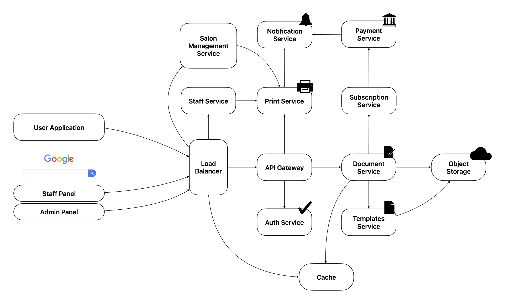

## Задание

[kata link](https://www.architecturalkatas.com/kata.html?kata=YouLookGoodInPrint.json)

### Оригинал

**You Look Good In Print** 
A local copy shop chain wants to offer its customers an "all-in-one" computing experience: 
document creation, editing, storage and printing.

Requirements:
- browser-based or –delivered;
- word processing;
- presentations;
- document templates (as start points);
- versioning;
- print scheduling;
- automatic and manual payment.

Users: initially, thousands in the local city, but potentially millions if the demand grows.

### Перевод

**You Look Good In Print** 
Местная сеть копировальных салонов хочет предложить своим клиентам "все-в-одном": 
создание, редактирование, хранение и печать документов

Требования:
- работа через браузер или через приложение;
- обработка текстов;
- презентации;
- шаблоны документов (как отправные точки);
- версионирование;
- планирование печати;
- автоматическая и ручная оплата.

Пользователи: первоначально тысячи в местном городе, но потенциально миллионы,
если спрос вырастет.

---

## Функциональные требования

1. Регистрация и авторизация
    - регистрация по электронной почте,
    - верификация электронной почты при регистрации,
    - восстановление пароля через почту,
    - авторизация с указанием почты и пароля.

2. Управление документами
    - просмотр существующих документов в базе пользователя,
    - создание пустого документа или выбор шаблона,
    - редактирование текста документа, вставка изображений, таблиц,
    - автоматическое сохранение изменений каждую минуту,
    - история версий документа: возможность перемещаться между определенными
    сохранениями (версиями) документа,
    - ограничение на размер одного документа - 4 Мб,
    - ограничение на размер хранилища пользователя - 10 документов,
    - оформление подписки для увеличения максимального размера документа до 32 Мб
    и максимального размера хранилища до 50 документов.

3. Бронирование времени печати
    - выбор ближайшего салона на карте (с определением геолокации),
    - просмотр свободных временных слотов на ближайшие 7 дней,
    - бронирование слота для конкретного документа,
    - возможность отменить бронирование не позднее чем за 1 час до ее начала.

4. Оплата
    - возможность в разделе оплаты изучить текущий тариф печати,
    - возможность оплаты онлайн (банковская карта или СБП),
    - выставление электронного чека на почту пользователя.

5. Работа сотрудников
    - сотрудник салона может просмотреть список предстоящих печатей со статусом оплаты:
    "оплачен" или "требует оплаты",
    - сотрудник подтверждает статус заказа: "в печати", "готов", "выдан".

6. Администрирование
    - добавление новых салонов и сотрудников, редактирование существующих салонов и учетных записей 
    сотрудников через интерфейс администратора,
    - управление расписанием работы салонов,
    - изменение тарифа печати.

## Нефункциональные требования

1. Производительность
    - ответ на создание/открытие/переход между разделами составляет не более 2 секунд
    при нормальной нагрузке,
    - ответ на редактирование содержимого документа происходит без видимых задержек,
    - ответ на сохранение документа составляет не более 1 секунды при нормальной нагрузке.

2. Масштабируемость
    - возможность увеличения числа пользователей без серьезных изменений в архитектуре системы.

3. Безопасность
    - защита данных пользователей: шифрование трафика и данных в храналище, 
    - аутентификация и авторизация пользователей,
    - защита платежей.

4. Надежность
    - автоматическое резервное копирование документов раз в день (ночью).

5. Совместимость
    - совместимость минимум с 2 последними версиями Chrome, Safari и Firefox,
    - возможность удобного использования на планшетах и мобильных устройствах.

---

## Сервисы

1. Сервис авторизации и аутентификации.
2. Сервис управления документами:
    - создание, редактирование, сохрнание документов,
    - автосохранение,
    - управление версиями,
    - проверка лимитов на документ.
3. Сервис шаблонов:
    - хранение и предоставление шаблонов документов.
4. Сервис печати:
    - бронирование слотов печати в салонах,
    - отмена брони,
    - интеграция с календарем сотрудников.
5. Сервис оплаты:
    - прием платежей,
    - генерация чеков,
    - проверка статуса оплаты.
6. Сервис управления салонами:
    - добавление/редактирование салонов,
    - управление расписанием,
    - назначение сотрудников.
7. Сервис подписок:
    - управление тарифами,
    - проверка активной подписки.
8. Сервис уведомлений:
    - email-уведомления,
    - push-уведомления.
9. Сервис сотрудников:
    - просмотр списка заказов,
    - изменение статусов ("в печати", "готово", "выдано").
10. API Gateway:
    - единая точка входа для всех клиентов,
    - балансировка нагрузки, маршрутизации и ограничение запросов.
11. Хранилище Object Storage:
    - хранение документов и шаблонов,
    - версионирование.
12. Реляционная БД:
    - хранение структурированных данных: пользователи, салоны, бронирования, платежи.
13. Кэш:
    - ускорение доступа к часто запрашиваемым данным (активные документы и список салонов),
    - сессии пользователей.
14. Брокер сообщений:
    - асинхронная обработка сообщений: автосохранение документов, уведомления и логирование.

## Взаимодействие

1. Сервис авторизации и аутентификации (`Auth Service`) -- сихнронное.
2. Сервис управления документами (`Document Service`):
    - **синхронные** запросы от фронтенда,
    - **асинхронное** сохранение в `Object Storage`,
    - интеграция с сервисом подписок `Subscription Service` для проверки тарифа.
3. Сервис шаблонов (`Templates Service`):
    - **синхронные** запросы от фронтенда при создании документа,
    - хранение данных в `Object Storage`.
4. Сервис печати (`Print Service`):
    - **синхронные** запросы от фронтенда (бронирование),
    - **асинхронные** уводмления через сервис уведомлений `Notification Storage`,
    - получение данных о салонах из сервиса салонов `Salon Management Service`.
5. Сервис оплаты (`Payment Service`):
    - **синхронные** запросы от фронтенда,
    - интеграция с внешними платежными системами,
    - отправка чеков через сервис уведомлений.
6. Сервис управления салонами (`Salon Management Service`):
    - **синхронные** запросы от панели администратора,
    - получения данных о бронировании от сервиса печати `Print Service`.
7. Сервис подписок (`Subscription Service`):
    - **синхронные** запросы от сервиса управления документами при сохранении,
    - интеграция с сервисом оплаты.
8. Сервис сотрудников (`Staff Service`):
    - **синхронные** запросы от панели сотрудников,
    - получение данных о заказах от сервиса печати.
9. `API Gateway`:
    - проксирование запросов к другим сервисам.
10. Хранилище `Object Storage`:
    - **асинхронная** загрузка/выгрузка через брокер сообщений.

## Схема взаимодействия

